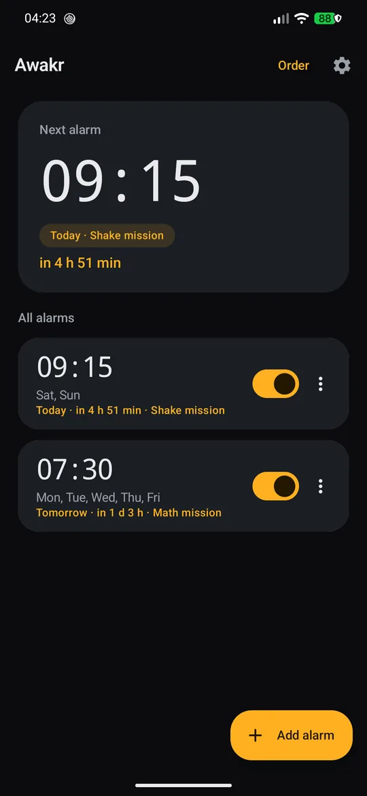
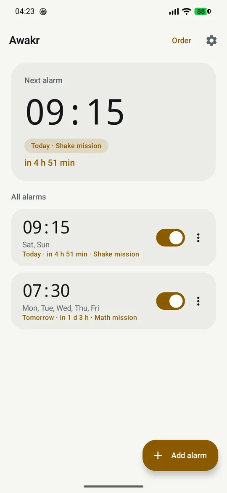
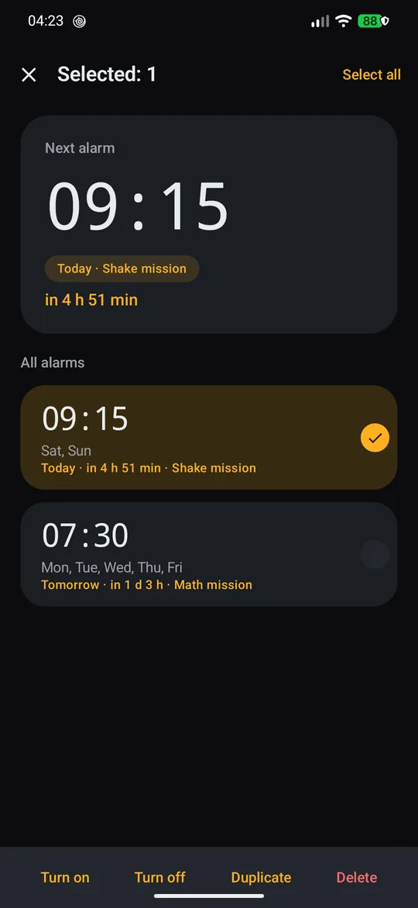
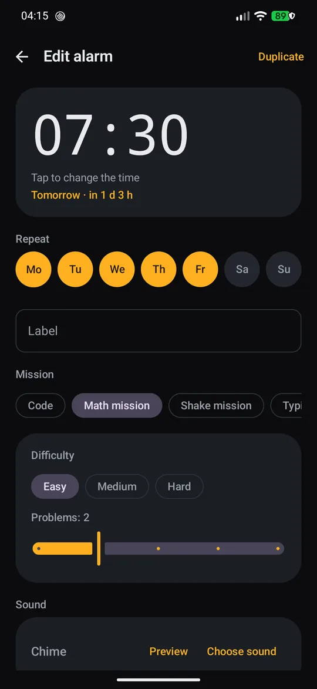
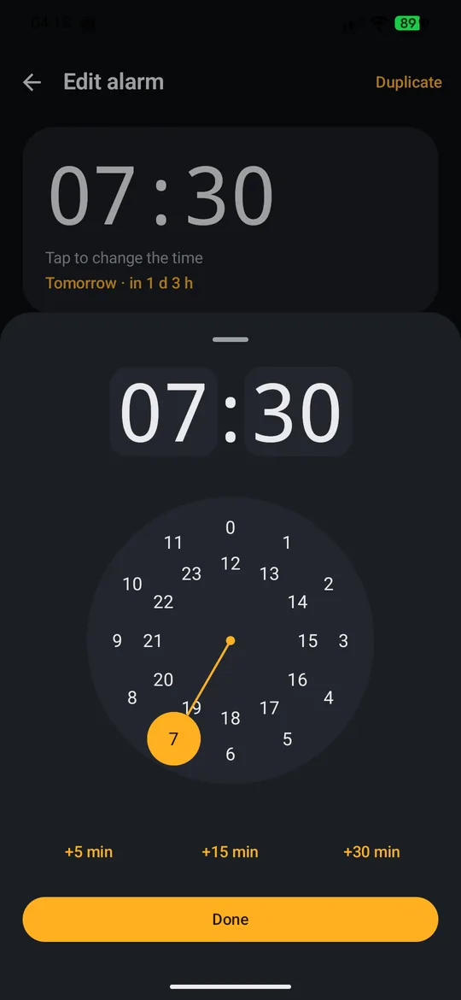
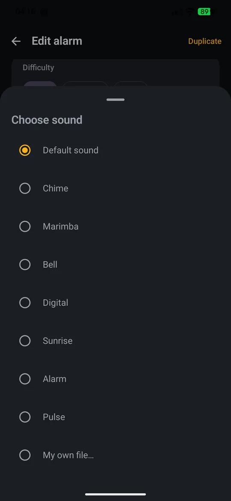
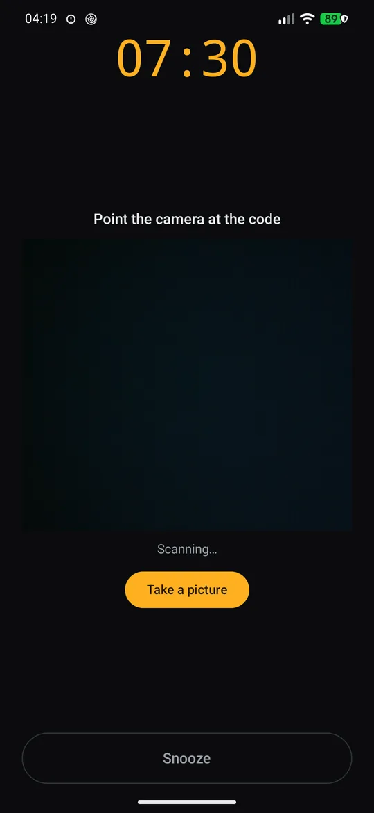
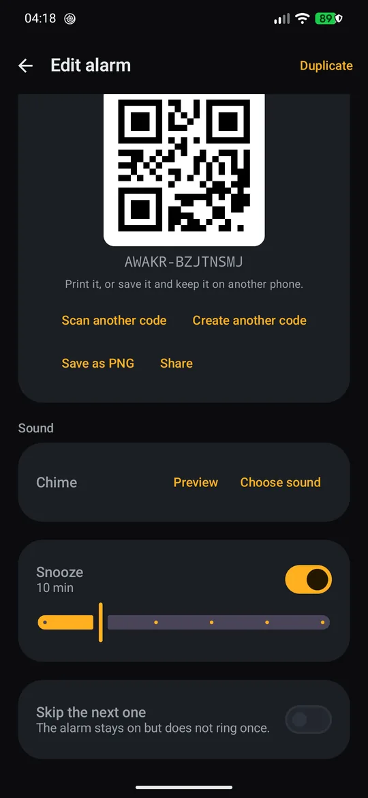
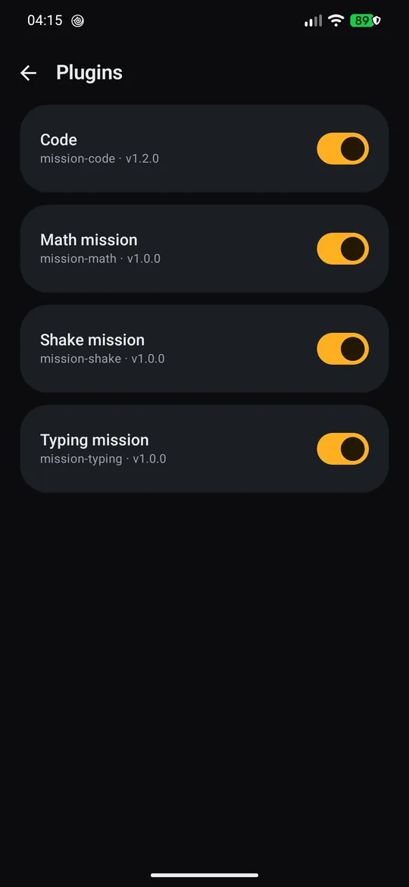

<div align="center">



<h1>Awakr</h1>

<p><b>An alarm clock that makes you get out of bed.</b><br>
No snooze button to slap half-asleep: an alarm stops only when you finish a mission —
solve arithmetic, shake the phone, retype a phrase, or scan a barcode you left in the bathroom.</p>

<p>
<a href="LICENSE"></a>


</p>

<p><sub>254 unit tests · release APK 5.3 MB · ru + en · clean-room, no third-party code, assets or sounds</sub></p>

<p>
<a href="https://caendeith.github.io/awakr/"><b>Website</b></a> ·
<a href="https://github.com/caendeith/awakr/releases/latest"><b>Download APK</b></a> ·
<a href="CONTRIBUTING.md">Contributing</a> ·
<a href="docs/manual-qa.md">What was tested by hand</a>
</p>

</div>

## Why another alarm clock

| What most alarm apps do | What Awakr does |
|---|---|
| Ads, subscriptions, analytics SDKs | MIT licensed, no ads, no in-app purchases, **no INTERNET permission at all** |
| A snooze button you can press half-asleep | a **mission** you have to complete; snooze is finite (3 by default) and can be turned off per alarm |
| Account, cloud sync, "wake-up insights" | everything stays on the device: Room + DataStore, nothing leaves the phone |
| Closed source, opaque behaviour | more than 10 700 lines of readable Kotlin, plugin architecture, every design decision written down in [docs/](docs/) |

## Screenshots

| Dark | Light | Multi-select |
|---|---|---|
|  |  |  |
| the next alarm, live countdown | same amber identity on a warm background | long press to act on many alarms |

| Editor | Time picker | Sounds |
|---|---|---|
|  |  |  |
| mission, sound, snooze, skip-next | bottom sheet with +5 / +15 / +30 min | 7 built-in tones or your own file |

| Code mission | Bind your own code | Plugins |
|---|---|---|
|  |  |  |
| point the camera at the code | or scan a barcode from a product | missions are build-time plugins |

## Highlights

- **Missions instead of a snooze button.** Eight plugins ship in the app: math, camera code (QR / EAN-13 / EAN-8 / UPC-A / Code 128), shake, typing, memory (Simon-style 4x4), find-the-colour, squats and steps (accelerometer, no step-counter permission). A disabled or broken mission falls back to a "hold to dismiss" safety screen so an alarm can never get stuck ringing.
- **Several missions in a row.** Chain up to three different missions on one alarm; each stage gets its own fresh task, the counter keeps counting and the alarm only stops after the last one.
- **A code you already own.** Rather than printing a generated QR, scan the barcode of a product you keep away from the bed and bind it to the alarm. Pointing the camera at it dismisses the alarm; an optional shutter saves the frame for later.
- **Reliability first.** Exact alarms via `setAlarmClock` (no SCHEDULE_EXACT_ALARM dance), re-scheduled on boot and on timezone/time changes, a foreground service with an alarm-usage audio stream, a full-screen ring activity over the lock screen, a fallback notification if a background start is blocked, and a queue so two alarms in the same minute do not cancel each other.
- **Snooze is honest.** 5-30 minutes per alarm, at most `max_snoozes` times (3 by default), and the counter travels with the alarm intent so a stray re-trigger cannot reset it.
- **Missed alarms are visible.** The platform logs nothing when an alarm could not ring, so on start and on boot Awakr compares the last scheduled occurrence against its log and reports a missed alarm as a card plus one notification.
- **Per-alarm sound.** Built-in tones grouped in "gentle" and "loud" packs, import any audio file from storage (copied into app storage, so the alarm still rings when the original moves), or record your own voice - 30 seconds, straight from the sound sheet.
- **A mission has a time limit.** While a mission is on screen the alarm goes quiet and a 90 second countdown runs; if it expires the sound comes back and a fresh task is generated, so stalling never gets you out.
- **No password to dismiss an alarm.** The ring screen is raised above the lock screen with the full-screen intent and never asks for the device PIN - it does not need the "display over other apps" permission either.
- **Both themes.** Dark by default (background `#0B0C0E`, amber `#FFB020`), a warm light palette (`#FBF8F4` / `#B87500`), and "follow the system".
- **Housekeeping gestures.** Long press to select many alarms, "..." menu for duplicate / skip-next / enable / delete, a configurable swipe, drag-to-reorder, and a five-second Undo on deletion.
- **A widget for the next alarm.** A Glance widget on the home screen shows the next alarm, how it repeats, and a "Skip next" action; it redraws itself whenever an alarm changes and after every ring.
- **Your data leaves in a file.** Export every alarm and setting to a JSON file through the system picker and restore it later - either merged into the current list or replacing it. Nothing is uploaded anywhere; the format is plain and documented.
- **A heads-up before the alarm.** An optional low-priority notification N minutes before (10, 20, 30 or 60), scheduled in the same window as the alarm, so a 06:30 wake-up is not a surprise.
- **Two languages, one switch, and Material You.** English and Russian, switchable inside the app without a restart (the mission screen follows), plus the system wallpaper palette on Android 12+ when you turn dynamic color on.
- **You find out how you actually wake up.** Every ring is logged; the stats screen shows a 7 or 30 day streak, how many you dismissed, snoozed or missed, your average wake-up time and the distribution across the day.
- **Two more ways to make sure you are awake.** An optional wake-up check that reminds you 100 seconds after dismissing ("did you really get up?") and a panic ramp that jumps the volume to full after 40 seconds of ringing. The label can be read out loud, and the accent colour is yours to pick.

## Install

There is no Play Store listing. Build the APK yourself or take the debug artifact from CI:

```bash
./gradlew :app:assembleRelease
adb install -r app/build/outputs/apk/release/app-release.apk
```

Requirements: Android 8.0 (API 26) or newer. Verified on a Pixel 7 Pro running Android 17 (API 37): alarms fire at the exact minute from an idle locked device, the ring screen is raised over the lock screen, every alarm survives a reboot, and each mission dismisses or snoozes the ring.

On first launch an onboarding screen asks for the permissions the app can actually use, and re-checks them every time you come back to the foreground.

There is also a self-hosted F-Droid repository, so updates arrive like any other F-Droid app:

```
https://caendeith.github.io/awakr/fdroid/repo
```

Fingerprint (SHA-256): `09 B3 D4 E7 27 89 22 EC F8 3E 5B 8B 02 13 99 63 9D F3 E4 AD 83 E0 5A 5C 3F F1 C1 C7 95 E3 3D 01`. Add the URL in F-Droid under Settings → Repositories. The APKs there are signed with the same key as the GitHub releases, so the two installs are interchangeable; a build from f-droid.org (if it ever lands there) would be signed with F-Droid's key and would replace this one.

## Permissions

| Permission | Why | Required |
|---|---|---|
| Notifications (API 33+) | fallback ring notification and the missed-alarm summary | yes |
| Exact alarms (API 31+) | `setAlarmClock` cannot schedule without it | yes |
| Camera | only the code mission, while the alarm rings, and the optional shutter | when the code plugin is on |
| Microphone | only while you record your own alarm sound from the sound sheet | when you use the recorder |

No `INTERNET`, no location, no contacts, no storage permission. CI fails the build if `INTERNET` ever appears in the merged manifest.

## Architecture

Awakr is built as a small core plus **build-time plugins**: a mission declares a manifest, an editor UI and a ring behaviour, and the registry binds it without reflection.

```kotlin
class HoldMissionPlugin : MissionPlugin {
    override val manifest = PluginManifest(
        id = "mission-hold",
        name = StringRes(R.string.plugin_hold_name),
        version = "1.0.0",
        capabilities = setOf(Capability.MISSION),
    )
    override val kind = "hold"
    @Composable override fun Editor(config: JsonObject, onChange: (JsonObject) -> Unit) { ... }
    @Composable override fun Mission(config: JsonObject, onSolved: () -> Unit) { ... }
}
```

Three lines wire it in (module include, dependency, one entry in the registry list) - the recipe is in [CONTRIBUTING.md](CONTRIBUTING.md#adding-a-mission-in-one-pull-request) and was verified end to end with a throwaway plugin.

| Module | Responsibility |
|---|---|
| `:app` | Compose UI (home, editor, ring, settings, onboarding), alarm service, receivers, DI-free wiring |
| `:core:time` | next occurrence, DST-safe scheduling, skip-next |
| `:core:alarm` | alarm model, day masks, snooze limit |
| `:core:audio` | sound player, built-in tones, sound resolution chain |
| `:core:notify`, `:core:perm` | notification channels, permission policy per API level |
| `:core:ui` | design system: colors, shapes, typography, cards, buttons |
| `:data` | Room (v2), DataStore settings, repositories |
| `:sdk`, `:plugin-runtime`, `:plugin-codegen` | plugin API, registry, declarative settings form, KSP codegen |
| `:plugins:mission-{math,code,shake,typing}` | the four mission plugins |

Room v1 to v2 migrates in place (sound, sort order, skip-next, soft delete); the migration is explicit and covered by tests.

## Build and test

Requirements: JDK 17, Android SDK (platform 36, build-tools 36.0.0). The Gradle wrapper is included.

```bash
./gradlew test                 # 254 unit tests
./gradlew :app:lintDebug       # hard-coded text, missing permissions, API misuse
./gradlew :app:assembleDebug   # debug build, installs beside release
./gradlew :app:assembleRelease # R8 + resource shrinking, signed if keystore.properties exists
```

Dependencies come from the official repositories (Google Maven, Maven Central) by default, which is what CI and the F-Droid build server use. On networks where those are unreachable set `AWAKR_MIRRORS=true` to switch `settings.gradle.kts` to the aliyun/huaweicloud mirrors this project was originally developed against; [docs/toolchain.md](docs/toolchain.md) explains the exact pins and the traps behind them.

Release signing is driven by an optional, git-ignored `keystore.properties`; without it the same task still succeeds and produces an unsigned APK. Measured release: **5.3 MB**, cold start **479 ms**.

## Status

| Phase | Scope | State |
|---|---|---|
| 0-7 | Toolchain, skeleton, storage + plugin SDK, alarm engine, home + editor, missions, onboarding, QA + release + CI | done |
| 8 | v1.1 UX pass: multi-select, per-alarm sounds, themes, code mission | done |
| 9 | v1.2: bind any scanned code (product barcode) to an alarm | done |
| 10 | v1.3: JSON backup and restore, Glance widget, sound packs and recording, Material You, pre-alarm notification, language switcher | done |
| 11 | v1.4: mission chains (up to 3), memory / colour / squat / step missions, wake-up check, statistics, spoken label, accent colours, panic volume | done |

Roadmap ideas for the next versions: a photo mission (compare a shot with a reference frame), sleep sounds with a sleep timer, alarm-linked habits, more barcode formats, Wear OS, and runtime-loaded plugin APKs (deliberately postponed - Play and F-Droid forbid them).

## Docs

- [docs/spec.md](docs/spec.md) - product and technical specification (v1 scope)
- [docs/spec-v1.1.md](docs/spec-v1.1.md) - v1.1 / v1.2 scope: UX pass, code mission, sounds, themes
- [docs/plan.md](docs/plan.md) - implementation plan, phases 0-7
- [docs/toolchain.md](docs/toolchain.md) - verified toolchain, versions and known pitfalls
- [docs/faq.md](docs/faq.md) - FAQ and troubleshooting (sound, lock screen, permissions, OEM battery savers)
- [docs/manual-qa.md](docs/manual-qa.md) - manual test matrix and results on real hardware
- [CONTRIBUTING.md](CONTRIBUTING.md) - build setup, code style, adding a mission in one pull request
- [docs/index.html](docs/index.html) - the landing page served at https://caendeith.github.io/awakr/ (GitHub Pages, `main` → `/docs`)

## License

MIT. See [LICENSE](LICENSE).

## Disclaimer

Awakr is an independent, clean-room implementation. It is not affiliated with, endorsed by, or derived from any other alarm application, and contains no code, assets or sounds from such applications.
